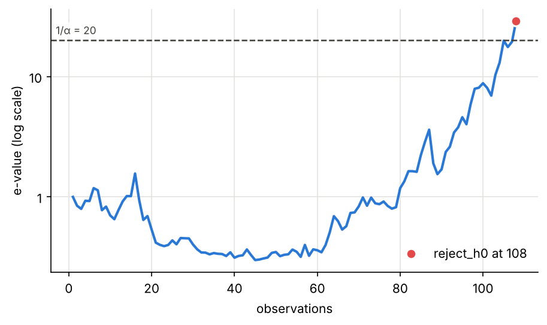
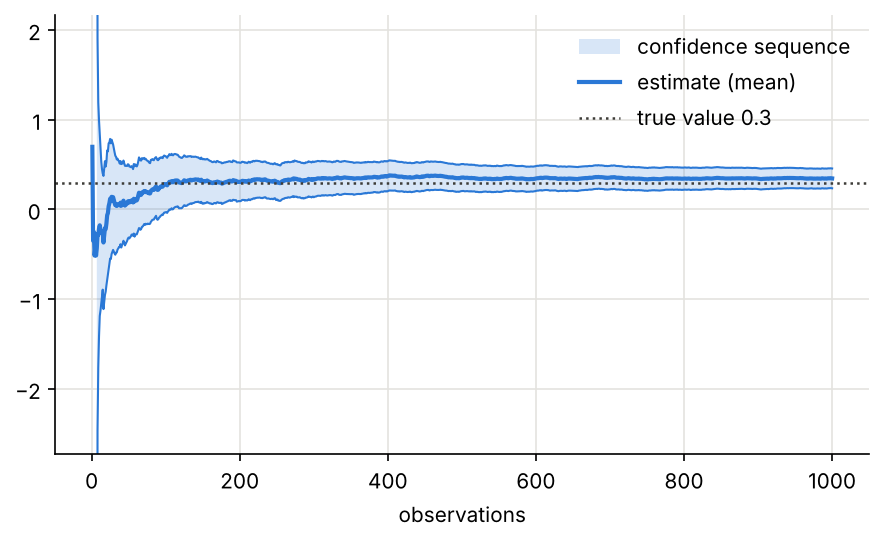
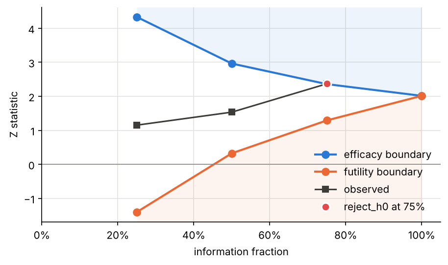
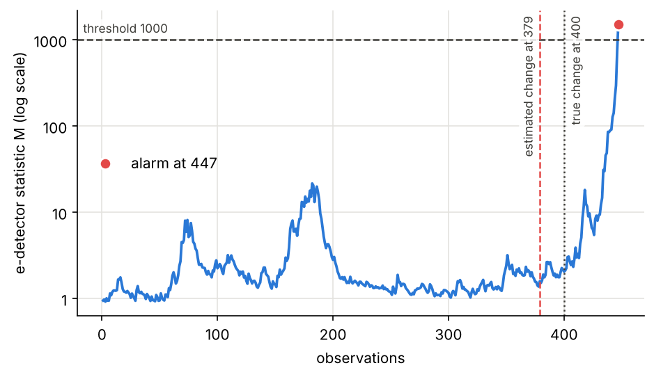
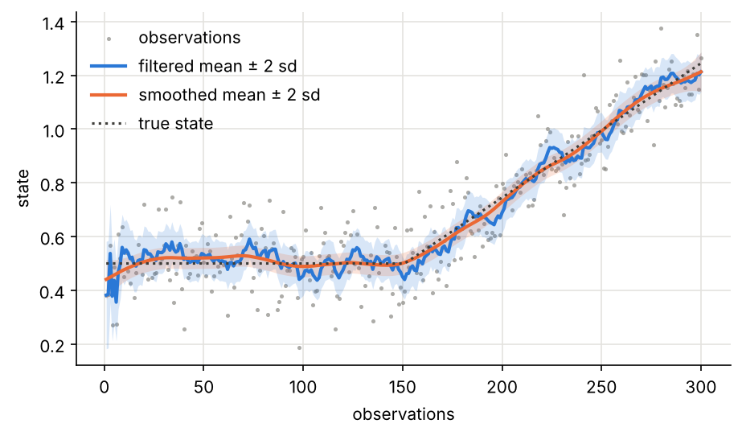
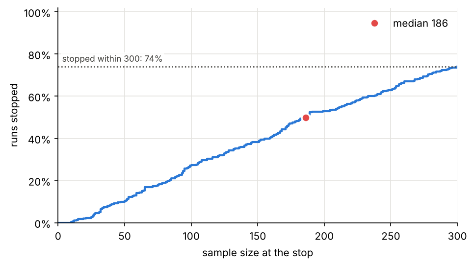
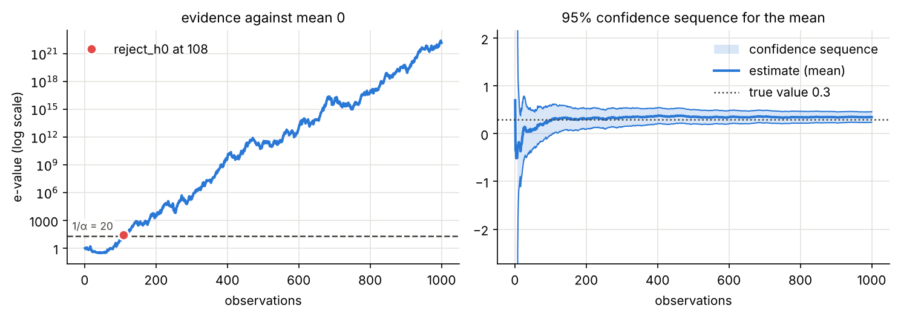

# Plotting runs, designs and plans

`sequential_analysis.plotting` draws the things a sequential analysis
produces: the evidence of a test as it accumulates, a confidence
sequence narrowing, the boundaries of a group sequential design, a
change detector's statistic, a filter's estimate, and the distribution
of stopping times from a plan.

It needs matplotlib, which is optional:

```bash
pip install "sequential-analysis[plot]"
```

Every function returns the matplotlib `Axes` it drew on. Pass `ax=` to
draw into a figure of your own; leave it out for a new figure. Nothing
is shown or saved for you: call `plt.show()`, or
`ax.figure.savefig("run.png")`.

The outputs of a run can be given in any form the library produces
them:

* a `Recorder` attached to the run as a consumer;
* a list of `OutputEvent`s;
* a list of outputs;
* the (state, output) pairs returned by `trajectory`.

The x axis is the procedure's own count: observations, units or events.

## 1. Evidence: the e-process of a test

An anytime-valid test rejects when its e-value reaches 1/α.
`plot_e_process` draws the e-value on a log scale, the threshold, and
the point where the test stopped. It finds the e-value field of any
test that has one (`log_e_value`, `log_bf`, `log_wealth`, ...); `field=`
names another.

```python
from sequential_analysis import Recorder, Run, run_sync
from sequential_analysis.plotting import plot_e_process
from sequential_analysis.procedures import TMixtureSPRT
from sequential_analysis.sources import gaussian

evidence = Recorder()
test = Run(TMixtureSPRT(theta0=0.0, effect=0.5, alpha=0.05), consumers=[evidence])
run_sync(test, gaussian("x", mean=0.3, sd=1.0, seed=3, n=2000))
print(test.state.decision, "after", test.t, "observations")

ax = plot_e_process(evidence, alpha=0.05)
```



For `MultipleTests` it draws one line per metric, the e-BH thresholds,
and marks each metric where it is first rejected.

## 2. Estimation: a confidence sequence

A confidence sequence covers the true value at every time
simultaneously. `plot_confidence_sequence` draws it as a band, with the
estimate inside.

Here the same test is kept running after it rejects, to watch the
interval narrow:

```python
from sequential_analysis.plotting import plot_confidence_sequence

interval = Recorder()
test = Run(TMixtureSPRT(theta0=0.0, effect=0.5, alpha=0.05, stop_on_reject=False), consumers=[interval])
run_sync(test, gaussian("x", mean=0.3, sd=1.0, seed=3, n=1000))
last = interval.outputs[-1]
print(f"after {last.n} observations: mean {last.mean:.3f}, 95% confidence sequence [{last.lower:.3f}, {last.upper:.3f}]")

ax = plot_confidence_sequence(interval, truth=0.3)
```



The first bounds of a confidence sequence are infinite or very wide.
Infinite ones are left out. The y range is chosen so that the very wide
start does not flatten the rest; `ax.set_ylim` changes it.

## 3. A group sequential design

`plot_group_sequential_design` draws the efficacy and futility
boundaries of a design against the information fraction. `observed=`
adds the path of a trial. It takes Z values, or the outputs of a
`GroupSequentialTest` run.

```python
from sequential_analysis.group_sequential import group_sequential_design
from sequential_analysis.plotting import plot_group_sequential_design
from sequential_analysis.procedures import GroupSequentialTest

design = group_sequential_design(0.025, [0.25, 0.5, 0.75, 1.0], spending="obrien-fleming",
                                 futility="obrien-fleming", power=0.9)
n_max = design.max_sample_size(effect=0.3, sigma=1.0)
trial = Recorder()
run = Run(GroupSequentialTest.from_design(design, n_max, sigma=1.0), consumers=[trial])
run_sync(run, gaussian("x", mean=0.3, sd=1.0, seed=11))
print("stopped after", run.t, "of", n_max, "patients:", run.state.decision)

ax = plot_group_sequential_design(design, observed=trial)
```



`scale="score"` draws the score B = Z√t instead. `scale="p"` draws the
nominal p-value of each boundary, on a log scale.

## 4. Change detection

`plot_detection` draws the statistic of a change detector, its
threshold and the alarm. It works for:

* CUSUM, on its own scale;
* Shiryaev–Roberts and the e-detectors, on a log scale, with the
  threshold you gave the procedure (`threshold=A` or `arl`);
* `BayesianChangePoint`, as the probability of a recent change.

An e-detector also estimates where the change began, which is drawn at
the alarm. `change_point=` marks the true change when it is known, as in
a simulation.

The data are the response times of
[the monitoring tutorial](tutorials/monitoring.md): the mean rises from
0.2 s to 0.3 s after request 400.

```python
import random

from sequential_analysis.plotting import plot_detection
from sequential_analysis.procedures import MeanEDetector
from sequential_analysis.sources import from_values

rnd = random.Random(4)
latency = ([min(1.0, rnd.gammavariate(2.0, 0.1)) for _ in range(400)]
           + [min(1.0, rnd.gammavariate(2.0, 0.15)) for _ in range(400)])

detection = Recorder()
detector = Run(MeanEDetector(m=0.2, lo=0.0, hi=1.0, arl=1000, direction="increase", statistic="cusum"),
               consumers=[detection])
run_sync(detector, from_values("x", latency))
print("alarm at request", detector.t, "-- change estimated at", detection.outputs[-1].change_estimate)

ax = plot_detection(detection, threshold=1000, change_point=400)
```



## 5. A filter, and the smoother afterwards

`plot_filter` draws a filter's mean with a band of ±2 standard
deviations. `observations=` and `truth=` add the data and the true
state. `smoothed=` adds the Rauch–Tung–Striebel smoother's estimates
over the same inputs. For a vector state, `component=` picks the
coordinate.

The level below drifts upwards from step 150; a local-linear-trend
Kalman filter follows it as the readings arrive:

```python
from sequential_analysis.plotting import plot_filter
from sequential_analysis.procedures import KalmanFilter
from sequential_analysis.smoothing import kalman_smoother

rnd = random.Random(5)
level = [0.5 * (1 + (t > 150) * (t - 150) / 100) for t in range(300)]
readings = [v + rnd.gauss(0.0, 0.1) for v in level]

model = KalmanFilter.local_linear_trend(level_noise=1e-5, slope_noise=1e-6, observation_noise=0.01)
filtered = Recorder()
run_sync(Run(model, consumers=[filtered]), from_values("y", readings))
smoothed = kalman_smoother(model, [{"y": y} for y in readings])
print(f"level at the end: filtered {filtered.outputs[-1].mean[0]:.3f}, true {level[-1]:.3f}")

ax = plot_filter(filtered, observations=readings, truth=level, smoothed=smoothed)
```



The smoothed line uses the readings that came later, too. It finds the
start of the drift that the filter could see only afterwards.

## 6. How long will it run? Stopping times of a plan

`planning.simulate` runs a procedure many times on simulated data.
`plot_stopping_times` draws the share of runs stopped by each sample
size. The curve ends at the power, since runs that never stopped do not
count. `kind="hist"` draws a histogram of the stopping times instead.

```python
from sequential_analysis.planning import simulate
from sequential_analysis.plotting import plot_stopping_times

plan = simulate(lambda: TMixtureSPRT(theta0=0.0, effect=0.5, alpha=0.05),
                lambda rnd: {"x": rnd.gauss(0.2, 1.0)}, runs=300, max_n=300)
print(f"power within 300 observations: {plan.power:.2f}, median {plan.median_n:.0f}")

ax = plot_stopping_times(plan)
```



A plain list of stopping times works as well.

## Several plots in one figure

With `ax=`, the plots go wherever you like, and are styled further with
matplotlib as usual:

```python
import matplotlib.pyplot as plt

fig, (left, right) = plt.subplots(1, 2, figsize=(10, 3.6), sharex=True)
plot_e_process(interval, alpha=0.05, ax=left)
plot_confidence_sequence(interval, truth=0.3, ax=right)
left.set_title("evidence against mean 0")
right.set_title("95% confidence sequence for the mean")
fig.tight_layout()
print("panels:", [ax.get_title() for ax in fig.axes])
```



The pictures on this page are made by running its code:
`python tools/make_plots.py`.

## Reference

::: sequential_analysis.plotting
    options:
      show_root_heading: false
      heading_level: 3
